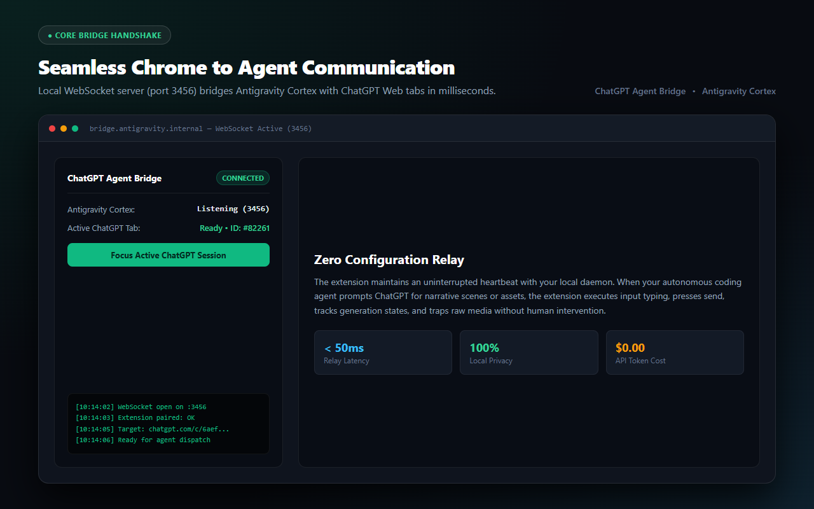
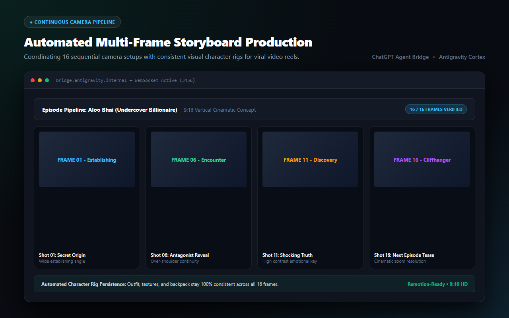

  
“I already pay $20 a month for ChatGPT Plus. Why on earth am I still paying OpenAI per-token API bills every time my agent needs to generate an image or test a prompt?”

Every time I worked on an automated video project or needed visual concept art, I was stuck in the most boring manual loop imaginable:

1. Open `chatgpt.com` in Chrome.
2. Manually write or paste the camera prompt.
3. Wait for ChatGPT to finish generating.
4. Right-click the image, click "Save As", rename the file, and drag it into my code project.
5. Notice a small continuity flaw in the character's clothing, write another prompt, and repeat the whole thing from scratch.

If you are producing a 16-frame storyboard for a video clip, you easily waste two hours doing work a computer should be doing for you.

And if you try to automate it using OpenAI's official API? You get charged per image, per prompt, and hit with monthly credit limits—despite already having an active ChatGPT Plus subscription running in your browser.

---

## So I Built the Bridge

I decided to connect my browser directly to my coding agents.

The concept is dead simple:
- You open ChatGPT in your normal Chrome browser.
- You install this lightweight extension.
- You run the local bridge command with your agent (Google Antigravity Cortex, Claude, Cursor, or any Python/Node script).

Now, my agent doesn't ask me to copy-paste anything. It opens the chat itself, writes the prompts, inspects the responses, uploads reference images, downloads the raw uncompressed PNGs straight to my hard drive, and re-prompts if something needs fixing.

  
  
The companion extension maintaining an instant local WebSocket connection on port 3456 with zero cloud relays.

---

## It Genuinely Feels Better Than the API

Using the web session through an autonomous agent actually beats the API in almost every way:

- **No API Invoices:** You pay nothing extra. It uses the web subscription you already have.
- **Autonomous Prompt & Re-Prompt Loops:** If frame 7 has the wrong backpack or background lighting, my agent spots it, writes a corrective instruction, and re-generates it automatically.
- **Full Quality Downloads:** The extension captures the original raw PNG file directly from the browser memory and saves it into my video folder with proper sequence names (`frame-001.png`, `frame-002.png`, etc.).
- **Total Local Privacy:** Everything runs locally on `127.0.0.1:3456`. No third-party servers see your prompts or tokens.

  
  
Coordinating 16 sequential shots with consistent character styling for 9:16 vertical video reels.

---

## Anyone Can Use It For Free

I built this to solve my own headache, and I've made the entire package and extension completely free and open-source so anyone can use it.

### 1. Run the Bridge (Terminal)
Launch it directly via `npx`—no git cloning required:

  npx @codex.nayem/chatgpt-agent-bridge

### 2. Connect Your Agent (MCP Config)
Add this into your `antigravity.json` or `claude_desktop_config.json`:

<pre style="margin:0; color:#38bdf8; font-size:0.85rem; line-height:1.6;">{
  "mcpServers": {
    "chatgpt-bridge": {
      "command": "npx",
      "args": ["-y", "@codex.nayem/chatgpt-agent-bridge"]
    }
  }
}</pre>

### 3. Open ChatGPT & Go
Load the unpacked extension into Chrome, open `chatgpt.com`, and let your AI agent do all the prompting, testing, and downloading for you.

  <a class="ht-btn-primary ht-btn--glow" href="https://github.com/nasratulnayem/chatgpt-agent-bridge" target="_blank" rel="noopener noreferrer" style="padding: 12px 24px; font-size: 1rem;">
    <i class="fab fa-github" style="margin-right: 8px;"></i> Star &amp; Clone on GitHub ↗
  </a>
  <a class="ht-btn-secondary" href="https://www.instagram.com/nasratulnayem/" target="_blank" rel="noopener noreferrer" style="padding: 12px 24px; font-size: 1rem;">
    <i class="fab fa-instagram" style="margin-right: 8px;"></i> Follow on Instagram ↗
  </a>

